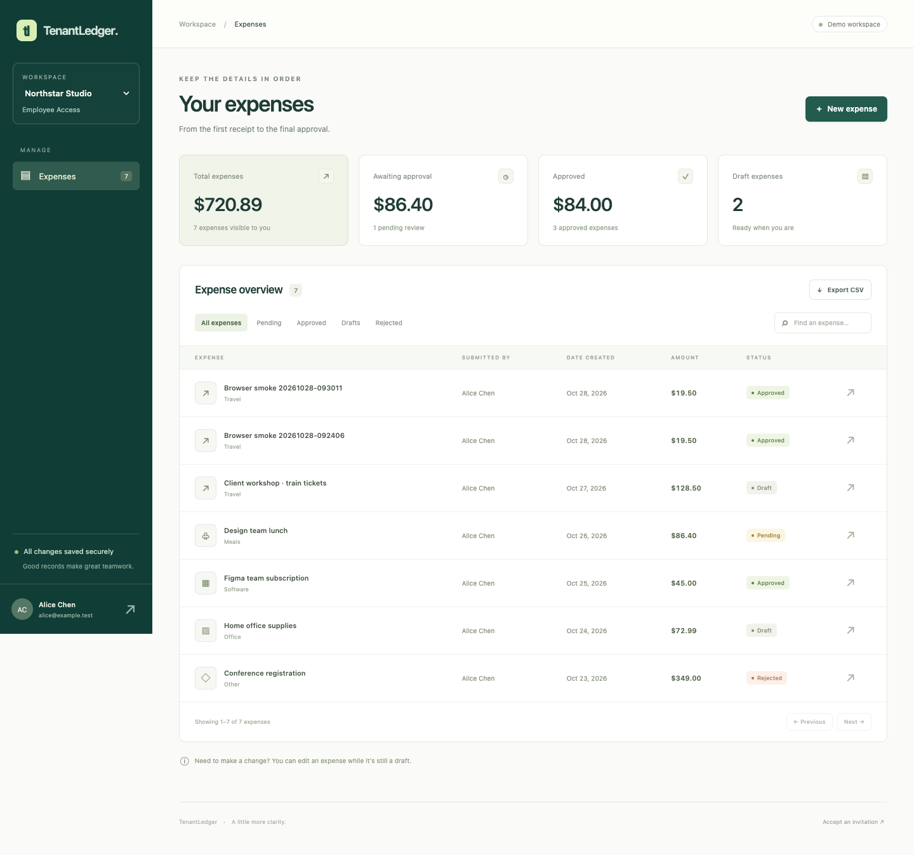

# TenantLedger

**Multi-tenant expense approvals with an executable authorization security lab.**

TenantLedger is a complete local portfolio application: a Python API, PostgreSQL,
Keycloak sign-in, a responsive web interface, and security tests that prove both
allowed behavior and rejected attacks. Two seeded organizations share one database.
One user belongs to both organizations with different roles.



## Run it

Prerequisites: Docker Engine / Docker Desktop with Compose, Python 3, and Make.
The first run downloads container images and Python dependencies.

```sh
make up
```

Open **[TenantLedger](http://localhost:8000)**. API documentation is at
**[localhost:8000/docs](http://localhost:8000/docs)** and the OpenAPI specification
at **[localhost:8000/openapi.json](http://localhost:8000/openapi.json)**.

`make up` generates fresh local encryption/session secrets without overwriting an
existing `.env`, applies migrations, imports the demo identity realm, and seeds data.
The `.env` file is excluded from version control. All published ports bind to loopback.

| Account | Northstar Studio | Juniper Labs |
| --- | --- | --- |
| `alice` | Employee | — |
| `bob` | Approver | — |
| `carol` | Organization admin | — |
| `diana` | Auditor | — |
| `alex` | Employee | Organization admin |
| `eve` | — | Employee |
| `frank` | — | Approver |
| `grace` | — | Auditor |
| `heidi` | No initial membership; use for invitations | — |

Every synthetic user has password **`LedgerDemo123!`** and email
`<username>@example.test`. Keycloak administration is available at
[localhost:8080](http://localhost:8080), using `admin` / `local-admin-password`.
These are deliberately public **local demonstration credentials**.

## What is implemented

- Draft creation/editing, receipt uploads/downloads, submission, approval and rejection.
- Organization switching with current membership and organization-specific roles.
- Object ownership, assigned approver checks, protected request fields, and workflow rules.
- PostgreSQL RLS for expenses, receipts and audit records; a non-owner runtime database role.
- OIDC authorization code flow with PKCE, state and nonce checks; encrypted server-side token storage.
- JWT signature/issuer/audience/lifetime validation plus uncached Keycloak introspection.
- CSRF-protected cookie writes, opaque HttpOnly sessions, session rotation, and provider logout.
- Invitations bound to verified email, one-time acceptance, expiration, and last-admin protection.
- Administrative reassignment without granting admins general access to expense contents.
- Append-only audit access for the API role, structured denial logs, pagination and scoped CSV export.
- Real PostgreSQL and Keycloak tests, concurrency tests, property-based input checks, and a browser smoke test.
- Five isolated vulnerable source variants with reproducible fixes and regression detection.

USD is the only supported currency. Amounts are integer cents, avoiding floating-point
arithmetic in the database/API. Receipts are restricted to five per expense, up to
2 MB each, with basic PDF/PNG/JPEG signature checks and attachment-only downloads.

## Verify it

```sh
make test       # Real PostgreSQL + Keycloak; isolated ledger_test database
make lab        # Secure baseline passes; five vulnerable variants must be detected
make lint       # Ruff in the test container
```

`make test` writes JUnit XML and statement coverage to `artifacts/`. `make lab`
writes an exact patch, assertion output and XML per variant, plus a JSON detection
report. The lab fails if an experiment encounters an import/setup error instead
of the expected security assertion. It never exposes a vulnerable network service.

Browser verification is optional locally and included in CI:

```sh
python3 -m venv .venv
.venv/bin/pip install playwright==1.64.1
.venv/bin/python -m playwright install chromium
.venv/bin/python scripts/browser_smoke.py
```

Alternatively set `CHROME_EXECUTABLE` to an existing Chrome executable. This script
performs real login/logout, checks desktop/mobile layouts, creates one synthetic
expense, attaches a receipt, submits it, approves it as another user, and checks
organization-specific roles. It leaves that labeled synthetic expense in the demo
and saves screenshots/report under `artifacts/browser/`.

Do not run `make test` and `make lab` concurrently: both reset `ledger_test`.
Neither resets the interactive `ledger` database. Real identity tests briefly alter
the dedicated `heidi` account and log `grace` out; restoration is in `finally` blocks.

## Review the security work

| Document | Purpose |
| --- | --- |
| [Architecture](docs/architecture.md) | Request flow, schema, trust boundaries and tradeoffs |
| [Permission matrix](docs/permissions.md) | Explicit role, relationship and state rules |
| [Threat model](docs/threat-model.md) | Assets, adversaries, controls and residual risks |
| [Vulnerability case studies](docs/vulnerabilities.md) | Five reproducible flaws, root causes and fixes |
| [Verification record](docs/verification.md) | Actual local results and their limits |
| [Demo walkthrough](docs/demo.md) | A short presentation and interview discussion guide |
| [Operations](docs/operations.md) | Configuration, lifecycle semantics and troubleshooting |

## Repository map

```text
app/                 FastAPI, identity integration, policies, models, web UI
alembic/             Versioned database schema and RLS migration
infra/               Development database roles and Keycloak realm
tests/               Authorization, identity, database, lifecycle and input tests
lab/                 Isolated vulnerable source transformations and runner
scripts/             Secret generation and browser verification
docs/                Architecture, threat model, cases, screenshots and evidence
.github/workflows/   CI: lint, Docker tests, mutation lab and real browser workflow
```

The UI uses plain HTML/CSS/JavaScript; no Node build step is needed. Python dependency
versions are locked in `requirements.lock` and `requirements-test.lock` for the
container builds. Swagger UI assets are vendored under `app/static/vendor/`, so API
documentation does not depend on a third-party CDN at runtime.

## Stop and resume

```sh
make down       # Stops this project's containers; preserves the named database volume
make up         # Resumes with saved data
```

This is a **local portfolio deployment**, not a production deployment template.
Production work would include managed secrets and TLS, hardened Keycloak hosting,
rate limits at ingress, backup/restore drills, an external audit sink, receipt malware
scanning, and a documented operational ownership model. See [operations](docs/operations.md).

## License

MIT for this project. Vendored Swagger UI is Apache-2.0; its license is included
in `app/static/vendor/LICENSE`. See [third-party notices](THIRD_PARTY_NOTICES.md).
