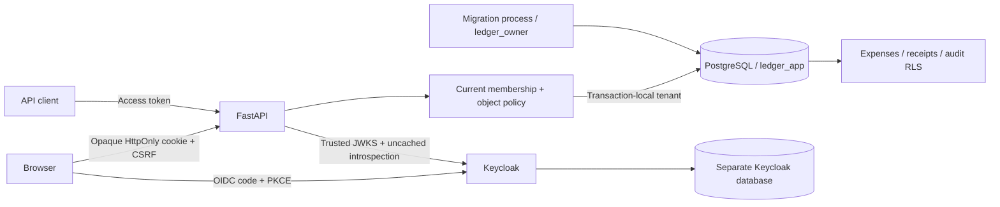
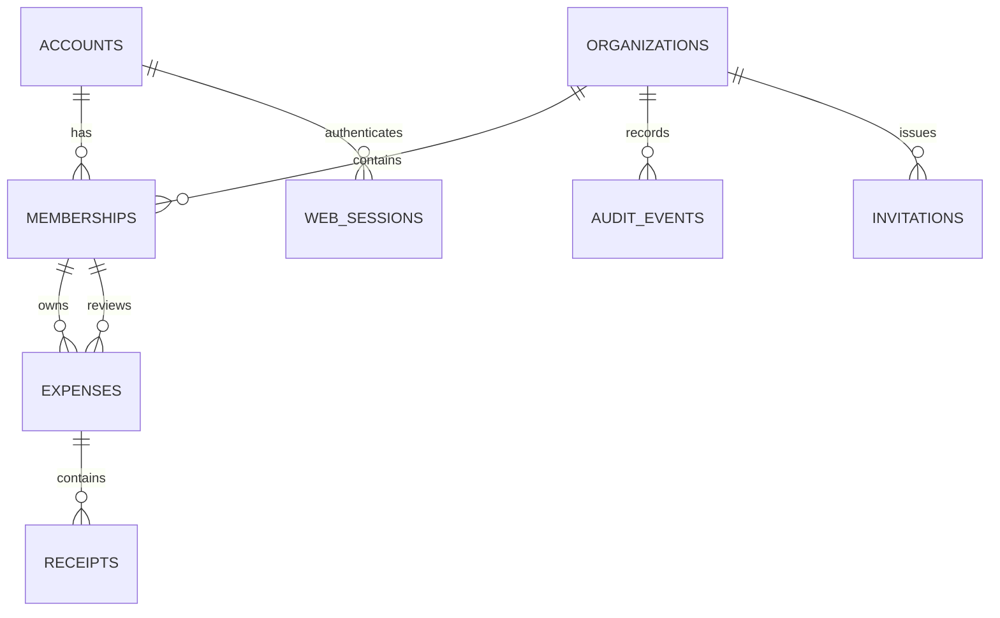

# Architecture and decisions

TenantLedger uses one synchronous FastAPI application and one PostgreSQL server.
Keycloak has a separate database and database role. `ledger` contains the interactive
demo, while `ledger_test` is reset by tests. Both use the same versioned schema.

## Identity and sessions

1. `/auth/login` generates state, nonce and a PKCE verifier. A signed, five-minute,
   HttpOnly cookie holds the flow state. The browser goes to the configured issuer.
2. `/auth/callback` checks state, exchanges the code using the PKCE verifier and
   confidential browser client, validates the ID token's audience/signature/nonce,
   and verifies that the ID/access tokens identify the same subject.
3. The API returns a random opaque session cookie. Its SHA-256 digest indexes the
   server-side session; token values are encrypted with Fernet. Existing browser
   sessions are rotated. No bearer/refresh token goes into localStorage.
4. Each API request validates a bearer token or the server-side session's token.
   The JWT must use RS256, the configured issuer and API audience, a valid time
   interval, required identity claims, and the access-token `typ` claim.
5. A separate confidential `tenantledger-api` client introspects the token at
   Keycloak on every request. A browser client should not be used for resource-server
   introspection. Provider failure returns 503 without granting access.
6. The application loads current local account status and current organization
   membership. It never grants a role based on a browser-supplied organization or
   a stale token role claim.

The public browser login client cannot use password grants. A separate `ledger-test`
client enables them solely for local integration testing. It must be removed from
any non-demo realm. IdP-managed MFA can be added through Keycloak without creating
a password-handling route in the application.

Browser sessions expire at the earlier of the access token expiry (five minutes in
the demo) and the configured session limit. Refresh tokens returned during browser
login are not persisted. Users sign in again; an existing Keycloak SSO session may
make that immediate. The test suite separately exercises provider refresh semantics.

Cookie writes require the expected Origin and a constant-time CSRF token comparison.
Bearer requests are authenticated independently and do not use cookie CSRF state.
Logout removes the local session even if the token expired, then redirects through
the provider's logout endpoint. Unauthenticated responses never contain session tokens.

## Authorization and transaction boundaries

The `tenant` dependency validates current membership before setting database context.
`visible_expenses` defines the common read scope used by detail, list, summary and
export endpoints. Receipt routes additionally authorize the parent expense. Mutation
routes check object relationships and expense state as well as organization role.

All request database work shares one transaction. A successful state change and its
audit event commit together. Exceptions roll the transaction back. Denied operations
are logged without authorization headers, request bodies or query strings.

`SELECT ... FOR UPDATE` serializes expense transitions. A client version number
rejects stale updates with 409. Two simultaneous approval decisions produce one
state transition and one approval/rejection audit event.

Organization membership changes acquire a transaction-scoped advisory lock keyed by
organization ID, serializing the check
that at least one active administrator remains. Already running requests can finish
after an authorization decision; the documented guarantee is that the next membership
check observes a committed change. This is not a distributed revocation SLA.

## Data model

Business records carry an organization ID. Composite foreign keys prevent an expense
owner/approver or receipt parent from belonging to another organization. Memberships
are deactivated rather than deleted so historical references remain valid. API amounts
are bounded integer USD cents. SQL constraints also restrict statuses, amounts,
currency and self-assignment.

## Database isolation

The API uses `ledger_app`, a non-owner, non-superuser role without BYPASSRLS. Migration
0002 narrows its table grants to required operations: for example, it cannot delete
expenses/memberships/receipts, edit account status, or modify organizations. Startup
fails if a privileged role is supplied. RLS with `USING` and `WITH CHECK` is forced on
expenses, receipts and audit events. Missing tenant context denies those rows.

The API sets `app.tenant_id` with `set_config(..., true)`, making it transaction-local.
Tests force connection reuse through a one-connection pool and check both commit and
rollback. This is an extra defense against an omitted query filter, not a replacement
for object authorization or a barrier against arbitrary SQL execution as the app role:
the app role can set its own tenant context.

Accounts, organizations, memberships, sessions and invitations are control-plane
tables. They require cross-organization lookup for login, membership discovery or
invitation acceptance and do not use these tenant RLS policies. Their access is
explicitly restricted by application queries and route policies. The threat model
records this boundary rather than claiming database isolation for every table.

## Deliberate scope decisions

- A single service keeps the security boundaries reviewable.
- PostgreSQL byte storage avoids public object-storage URL bypasses for small receipts.
- Synchronous uncached introspection favors revocation freshness over latency/availability.
- Explicit Python policy functions are sufficient for this small permission model.
- Admins manage membership and assignments; their role does not automatically expose
  expense content. Assigned work metadata is separately authorized.
- Audit rows cannot be updated/deleted by the runtime role. A privileged database
  operator can still alter them; these are not cryptographically immutable logs.

References: [Keycloak OIDC endpoints](https://www.keycloak.org/securing-apps/oidc-layers),
[PostgreSQL RLS](https://www.postgresql.org/docs/current/ddl-rowsecurity.html), and
[OWASP multi-tenant guidance](https://cheatsheetseries.owasp.org/cheatsheets/Multi_Tenant_Security_Cheat_Sheet.html).
